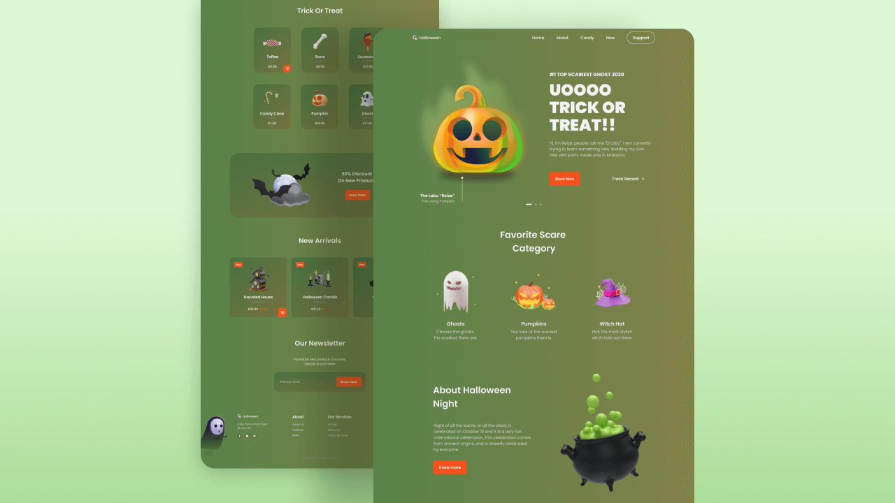

# 🎃 Halloween Night — Responsive Website

A fully responsive, feature-rich Halloween-themed e-commerce landing page built with **HTML5**, **SCSS**, and **Vanilla JavaScript**. No frameworks, no back-end — just clean, well-structured front-end code.



---

## ✨ Features

### Core UI
| Feature | Details |
|---|---|
| 🎠 Hero Slider | Swiper.js carousel with 3 animated slides and pagination |
| 🛍️ Trick or Treat Grid | Product cards with hover-reveal cart buttons |
| 🆕 New Arrivals Slider | Centred auto-width Swiper carousel |
| 💸 Discount Banner | Promotional section with scroll-reveal animation |
| 📧 Newsletter | Email subscribe form |
| 🦶 Footer | Multi-column layout with social links and decorative illustrations |

### JavaScript-powered Enhancements
| Feature | Details |
|---|---|
| ⏳ Halloween Countdown | Banner counting days / hrs / min to Oct 31, rolls to next year automatically, updates live every minute |
| 🛒 Shopping Cart | Add-to-cart from New Arrivals, quantity controls, remove, subtotal, demo checkout modal — all persisted to `localStorage` |
| ❤️ Favourites | Heart-toggle on every New Arrivals card, persisted to `localStorage`, with a live badge in the nav |
| 🔍 Search & Filter | Instant client-side filtering of the Trick or Treat section as you type — no page reload |
| 🎨 Theme Switcher | Green · Red · Black themes, choice saved to `localStorage` and restored on load |
| 🌑 Auto Dark Mode | Reads `prefers-color-scheme: dark` to set the Black theme as the default on first visit |
| 🖼️ Lazy Loading | All below-the-fold `` tags use `loading="lazy"` |
| ♿ Accessibility | `aria-label` on every icon-only control, `aria-pressed` on toggles, `aria-live` on the countdown, `:focus-visible` outlines, full alt-text |
| 🎉 Confetti Burst | CSS-keyframe candy/emoji explosion on "Book Now" — zero external libraries |
| 🔄 Scroll Animations | ScrollReveal.js entrance animations on all major sections |
| 🔝 Scroll-to-top | Button appears after 460 px of scroll |
| 📌 Active Nav Link | Highlight updates as the user scrolls through sections |
| 📲 PWA / Offline | Web App Manifest + service worker with cache-first strategy |

---

## 🛒 Shopping Cart

The cart is a pure front-end feature — no backend, no payment processing.

- **Add to cart** via the cart icon on any New Arrivals card. Adding the same item again increments the quantity.
- **Cart drawer** slides in from the right, showing each item's image, name, unit price, quantity `+`/`−` controls, and a remove button.
- **Subtotal** updates live as quantities change.
- **Checkout** opens a confirmation modal making it clear this is a demo; clicking "Clear Cart" resets the cart.
- Everything persists across page reloads via `localStorage` under the key `halloween-cart`.
- Fully keyboard-accessible: Escape closes the drawer/modal, all controls have `aria-label`.

---

## ⏳ Countdown Timer

A banner at the top of the page counts down to 31 October of the current year (rolls to next year if that date has passed). It sits in **normal document flow** (`position: static`) — `sticky` is not used because the ancestor `.main` has `overflow: hidden`, which breaks sticky at desktop widths.

---

## 🎨 Theme System

Three themes switchable via the colour dots in the nav bar. The active choice is saved to `localStorage` and restored on every visit.

| Theme | Body gradient | Container gradient |
|---|---|---|
| 🟢 Green *(default)* | `hsl(104→58, 28%, 40%)` | `hsl(104→58, 28%, 35%)` |
| 🔴 Red | `hsl(360→18, 28%, 40%)` | `hsl(360→18, 28%, 35%)` |
| ⚫ Black | `hsl(30, 8%, 8%)` solid | `hsl(30, 8%, 10%)` solid |

> On first visit the site reads `prefers-color-scheme`. A dark-mode OS setting automatically selects the Black theme.

---

## ♿ Accessibility

- All icon-only interactive elements carry `aria-label` attributes.
- Favourite and cart buttons use `aria-pressed` / `aria-label` to communicate state.
- Cart panel and modal use `role="dialog"` and `aria-modal="true"`.
- Countdown banner uses `aria-live="polite"`.
- Every `` has meaningful `alt` text.
- Keyboard focus is always visible via `:focus-visible` outline using `--first-color`.
- Escape key closes the cart drawer and modal.

---

## 📲 PWA / Offline Support

- `manifest.json` at root — name, short_name, theme/background colours, icon entries.
- `assets/js/sw.js` — service worker with cache-first strategy, versioned cache (`halloween-v2`), pre-caches all core assets on install, cleans up stale caches on activate.
- Registered from `main.js` guarded with `'serviceWorker' in navigator`.

> **Icon note:** `icon-192.png` and `icon-512.png` must be placed in `assets/img/`. Generate them from `favicon.png` using any image editor (resize to 192×192 and 512×512 px). Until they exist the manifest will log a warning but the site will still work.

---

## 🗂️ Project Structure

```
responsive-halloween-website-main/
│
├── index.html                   # Single-page entry point
├── manifest.json                # PWA manifest
├── preview.png                  # Project screenshot
│
├── assets/
│   ├── css/
│   │   ├── styles.css           # Compiled output — do not edit directly
│   │   └── swiper-bundle.min.css
│   │
│   ├── scss/
│   │   ├── styles.scss          # Root manifest — imports all partials
│   │   ├── base/
│   │   │   └── _base.scss       # Reset, base elements, :focus-visible
│   │   ├── config/
│   │   │   └── _variables.scss  # All CSS custom properties
│   │   ├── theme/
│   │   │   └── _theme.scss      # Theme override hooks
│   │   ├── layout/
│   │   │   └── _layout.scss     # Container, grid, .main
│   │   └── components/
│   │       ├── _header.scss
│   │       ├── _countdown.scss  # Halloween countdown banner
│   │       ├── _home.scss
│   │       ├── _buttons.scss
│   │       ├── _category.scss
│   │       ├── _about.scss
│   │       ├── _trick.scss
│   │       ├── _discount.scss
│   │       ├── _new.scss
│   │       ├── _cart.scss       # Shopping cart drawer + modal
│   │       ├── _newsletter.scss
│   │       ├── _footer.scss
│   │       ├── _scroll.scss
│   │       └── _breakpoints.scss
│   │
│   ├── js/
│   │   ├── main.js              # All application JavaScript
│   │   ├── sw.js                # Service worker
│   │   ├── swiper-bundle.min.js
│   │   └── scrollreveal.min.js
│   │
│   └── img/
│       ├── favicon.png
│       ├── icon-192.png         # ⚠ Must be provided — see PWA note above
│       ├── icon-512.png         # ⚠ Must be provided — see PWA note above
│       └── ...                  # All other site images
```

---

## 🛠️ Tech Stack

| Technology | Role |
|---|---|
| HTML5 | Semantic markup |
| SCSS (partials) | Modular, variable-driven styling |
| CSS Custom Properties | Runtime theming |
| Vanilla JavaScript (ES6+) | All interactivity |
| [Swiper.js](https://swiperjs.com/) | Touch-friendly sliders |
| [ScrollReveal.js](https://scrollrevealjs.org/) | Scroll entrance animations |
| [Boxicons](https://boxicons.com/) | Icon set |
| [Google Fonts — Poppins](https://fonts.google.com/specimen/Poppins) | Typography |

---

## 🚀 Getting Started

No build step required to view the site. Open `index.html` in any modern browser.

```bash
# Clone the repo
git clone https://github.com/your-username/responsive-halloween-website.git

# Open in browser
start index.html       # Windows
open index.html        # macOS
xdg-open index.html    # Linux
```

To edit styles, compile SCSS → `assets/css/styles.css`:

```bash
# Sass CLI (watch mode)
sass --watch assets/scss/styles.scss assets/css/styles.css

# VS Code: Live Sass Compiler extension → click "Watch Sass" in the status bar
```

> **Note:** The service worker only activates when the page is served over HTTP/HTTPS, not from `file://`. Use a local server (e.g. VS Code Live Server, `npx serve .`) to test offline/PWA features.

---

## 📸 Page Sections

1. **Header / Nav** — sticky, colour-changes on scroll, mobile hamburger, theme switcher, favourites badge, cart badge
2. **Countdown Banner** — live days · hrs · min until Halloween (static flow, no sticky)
3. **Home Slider** — 3-slide hero with ghost characters and "Book Now" confetti burst
4. **Category** — Ghosts · Pumpkins · Witch Hats with hover lift
5. **About** — floating illustration, scroll-reveal text
6. **Trick or Treat** — searchable product grid with add-to-cart buttons
7. **Discount** — 50 % off promotional banner
8. **New Arrivals** — swipeable cards with favourites toggle and add-to-cart
9. **Newsletter** — email subscription form
10. **Footer** — links, social icons, decorative illustrations

---

## 📄 License

Original design by [Bedimcode](https://www.youtube.com/c/Bedimcode).  
Enhanced with additional features for internship project purposes.
